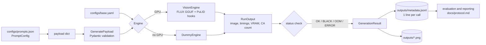

# flux-pulid

[](https://github.com/HOANOHOPE/flux-pulid/actions)
[](LICENSE)

Identity-preserving 2D image generation with **FLUX.1-dev (GGUF) + PuLID**, engineered to run on two
free-tier Kaggle T4 GPUs, with a strictly validated generation API, reproducible experiment
logging and a GPU-free test harness.

## 1. Overview

**Problem.** Generating a stylised (anime / cartoon / 2D) portrait that still looks like a given
person is a memory-hungry task: FLUX.1-dev (12B parameters) plus a T5-XXL text encoder does not fit
on a single 16 GB T4, and research code around it is typically notebook-bound, hard to reproduce
and impossible to test without a GPU.

**What this repository provides**

- A **single, typed entry point** `generate(payload) -> GenerationResult` that wraps FLUX GGUF
  quantisation (Q4_0 / Q8_0), a two-GPU `split` layout and PuLID identity injection via forward hooks.
- A **Pydantic data contract** (`src/schema.py`): invalid input raises immediately, while runtime failures
  (CUDA OOM, black/NaN images, PuLID not firing the expected number of cross-attention calls) are
  *returned* as `status` values so long benchmark loops never crash.
- A **`DummyEngine`** with the identical interface, so pipelines and tests run on any laptop.
- An **experimental protocol** (`docs/protocol.md`) with frozen prompts/seeds (`configs/prompts.json`)
  and an identity-level data split log (`configs/selection_log.csv`, 30,000 images, no identity shared
  across train/validation/test, enforced by a test).
- **Measured benchmarks** of Q4_0 vs Q8_0 on 2x T4 (`results/README.md`): time per image, peak VRAM per
  GPU, identity similarity.

Key measured results (720x720, 20 steps, PuLID on, `split` layout):

| Model | Time / image | Peak VRAM GPU0 / GPU1 | ID similarity* |
|---|---|---|---|
| FLUX Q4_0 | 63.6 s | 8.2 / 7.3 GB | 0.794 |
| FLUX Q8_0 | 54.1 s | 14.0 / 7.3 GB | 0.801 |

\*InsightFace cosine similarity on a single reference identity - a smoke test, not the official metric.

## 2. Architecture



| Path | Role |
|---|---|
| `src/schema.py` | Pydantic models: `GeneratePayload`, `GenerationResult`, `PromptConfig`, `SelectionRecord` |
| `src/vision_core.py` | `BaseEngine`, `DummyEngine`, `VisionEngine`, `generate()` |
| `src/utils.py` | Config loading, git hash, logging, `retry` decorator, selection-log reader |
| `configs/` | `base.yaml` (model/device/generation settings), `prompts.json`, `selection_log.csv` |
| `scripts/` | `run_demo.py` (GPU-free demo), `check_secrets.py` (pre-commit token scan) |
| `notebooks/` | Kaggle notebooks for Gate G1 benchmarks: `flux_g1_clean.ipynb` (Q4_0) and `flux_g1_q8.ipynb` (Q8_0); outputs stripped, English |
| `tests/` | 24 pytest tests (payload validation, error classification, config schemas, split integrity) |
| `docs/` | Experimental protocol (English) and the `generate()` handoff contract (Vietnamese team notes) |
| `results/` | Gate G1 benchmark tables and analysis |

## 3. Installation and quick start

Requires Python 3.10+.

```bash
git clone https://github.com/HOANOHOPE/flux-pulid.git
cd flux-pulid
python -m venv .venv && source .venv/bin/activate
pip install -r requirements.txt

python -m pytest tests -q          # 24 passed
python scripts/run_demo.py         # runs generate() with the dummy engine, no GPU needed
```

```python
from src.vision_core import DummyEngine, generate

engine = DummyEngine.from_yaml("configs/base.yaml")
res = generate({"prompt": "anime portrait", "ref_image": "ref.jpg", "seed": 42,
                "tags": {"identity_id": "id01"}}, engine=engine)
print(res.status, res.metadata["ca_fired"])   # OK 400
```

**Real model (Kaggle, 2x T4).** Install `requirements-gpu.txt`, add the model datasets and the
`HF_TOKEN` secret (copy `.env.example` -> `.env` locally), replace `YOUR_KAGGLE_USER` in
`configs/base.yaml`, then:

```python
from src.vision_core import VisionEngine, generate
engine = VisionEngine.from_yaml("configs/base.yaml", quant="Q4_0", layout="split")
res = generate({"prompt": "...", "ref_image": "/kaggle/input/.../face.jpg"}, engine=engine)
```

To reproduce the G1 benchmark tables, import the notebooks in `notebooks/` into Kaggle (GPU T4 x2, Internet on) and follow the first cell.

Model weights are never committed (see `.gitignore`); run `python scripts/check_secrets.py` before each commit.

## 4. Roadmap

- [x] Typed generation contract with strict validation and failure-as-status semantics
- [x] FLUX Q4_0/Q8_0 + PuLID engine on 2x T4, with VRAM/time measurement (Gate G1)
- [x] GPU-free `DummyEngine`, 24 unit tests, CI, secret scanner
- [x] Experimental protocol, frozen prompts/seeds, identity-level split log
- [ ] Batch benchmark runner (`scripts/run_benchmark.py`) writing a results table
- [ ] Official identity metric (AdaFace / FaceNet) and failed-detection reporting
- [ ] LoRA fine-tuning support in `generate()` (payload fields already reserved)
- [ ] Move VAE off GPU0 to lower peak VRAM

See the open [issues](../../issues) for details.

## 5. Licenses and responsible use

Code in this repository is released under the [MIT License](LICENSE). It does **not** include any
model weights or datasets. Upstream components carry their own terms, which you must review before use:
FLUX.1-dev (non-commercial license), PuLID, InsightFace models, and the face datasets listed in
`docs/protocol.md` (e.g. CelebA-HQ, FFHQ). Only use reference photos of people who consented to it.

